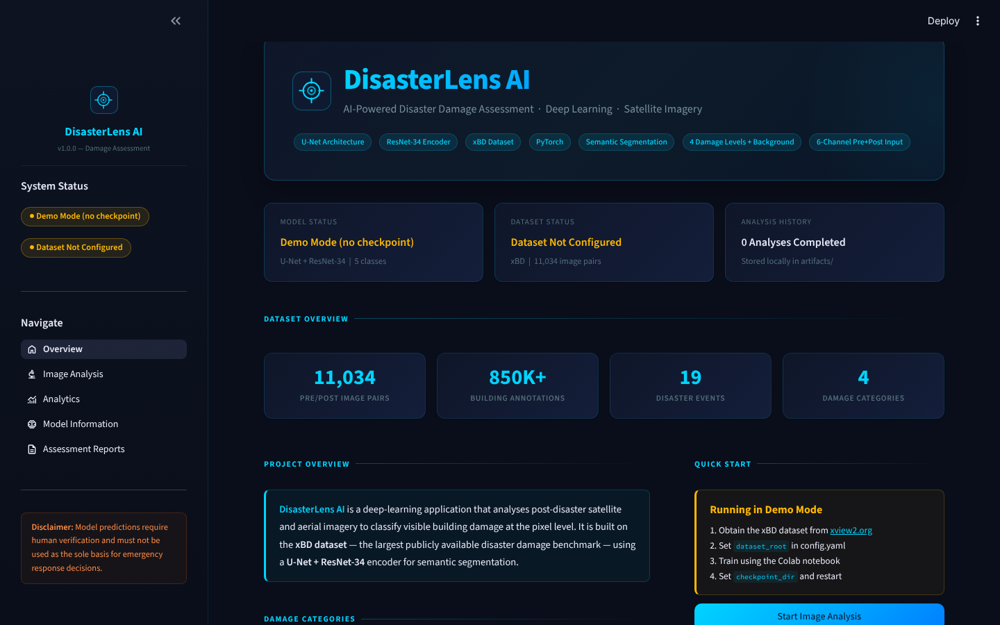
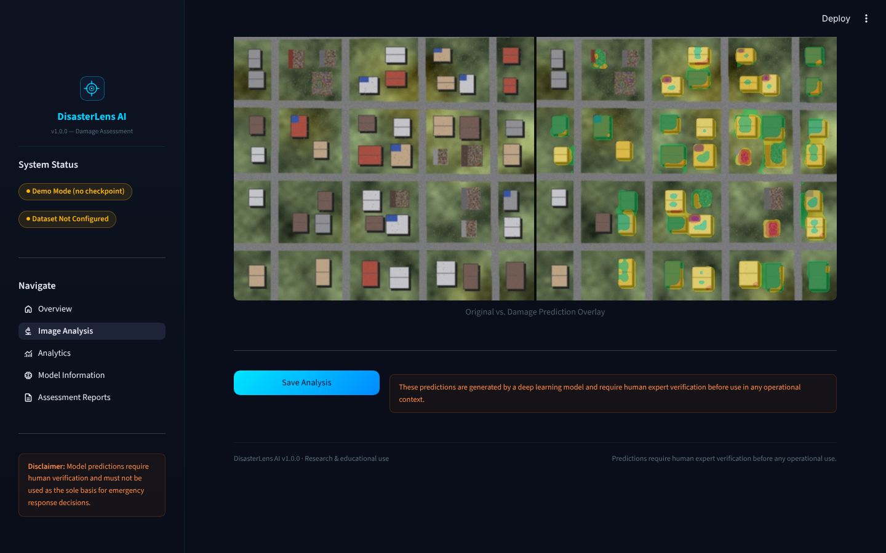
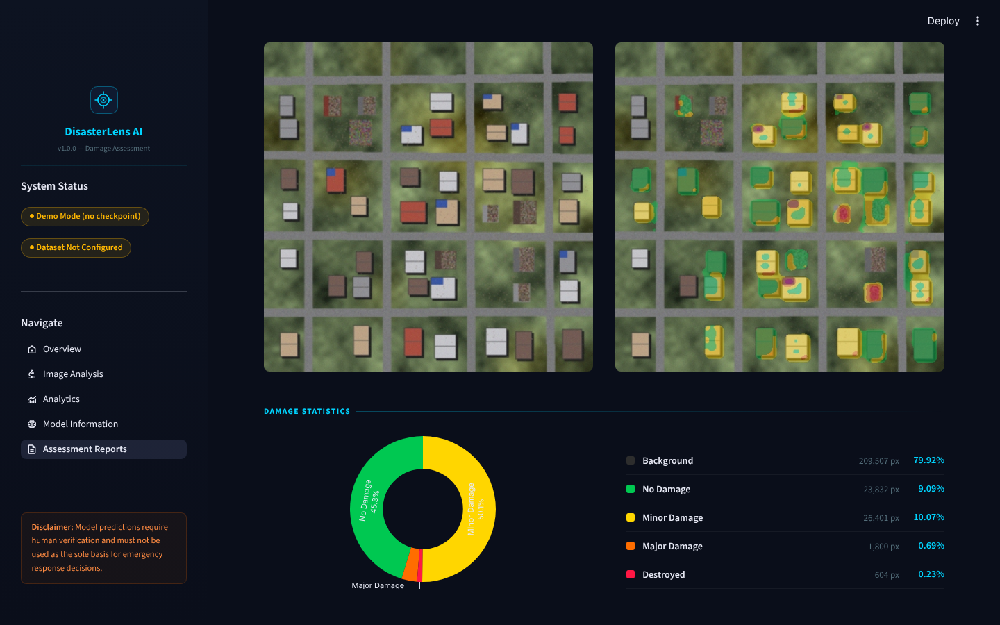

# DisasterLens AI

**Satellite-imagery building-damage assessment with deep learning.**

DisasterLens AI compares pre- and post-disaster imagery and labels every pixel as
*background*, *no damage*, *minor damage*, *major damage* or *destroyed*. A
U-Net with a ResNet-34 encoder is trained on the public
[xBD](https://xview2.org) benchmark, and results are presented in a multi-page
Streamlit dashboard with overlays, statistics, saved history and downloadable
PDF reports.


> **Disclaimer.** DisasterLens AI is a research and educational tool. Its output
> must be verified by qualified human analysts and must not be used as the sole
> basis for emergency response, structural-safety decisions or insurance claims.



---

## Contents

1. [Features](#features)
2. [Quick start](#quick-start)
3. [Using the app](#using-the-app)
4. [Demo mode vs. the trained model](#demo-mode-vs-the-trained-model)
5. [Training the model](#training-the-model)
6. [Evaluating and connecting the model to the app](#evaluating-and-connecting-the-model-to-the-app)
7. [Configuration reference](#configuration-reference)
8. [Project structure](#project-structure)
9. [How it works](#how-it-works)
10. [Testing](#testing)
11. [Troubleshooting](#troubleshooting)
12. [Limitations](#limitations)
13. [Roadmap](#roadmap)
14. [Acknowledgements and license](#acknowledgements-and-license)

---

## Features

| Area | What you get |
|------|--------------|
| Segmentation | 5 classes (background + 4 damage levels), 6-channel pre + post input |
| Dashboard | Overview, Image Analysis, Analytics, Model Information, Assessment Reports |
| Inference | Upload PNG / JPG / TIF (8- or 16-bit); pre/post images of different sizes are aligned automatically |
| Visualisation | Adjustable overlay opacity, side-by-side view, class mask, colour legend, per-class statistics |
| Reports | Saved analysis history and one-click PDF reports with imagery, statistics, model info and disclaimer |
| Analytics | Training curves, per-class precision / recall / F1 / IoU, row-normalised confusion matrix |
| Training | Focal + Dice loss, AdamW, cosine schedule, weighted sampler, AMP, event-level splits, resumable runs |
| Colab | Notebook that trains and evaluates on a free T4 GPU and survives disconnects |
| Demo mode | Works with **no checkpoint** using a clearly labelled heuristic predictor |
| Quality | 144 unit tests on synthetic data - no dataset or GPU needed |

---

## Quick start

Requires **Python 3.10 or newer**. The first install downloads PyTorch (large).

```bash
# 1. Create an isolated environment
python -m venv .venv
source .venv/bin/activate          # Windows: .venv\Scripts\activate

# 2. Install dependencies
pip install -r requirements.txt

# 3. Launch the dashboard
streamlit run app.py
```

Open <http://localhost:8501>. With no checkpoint present the app starts in
**demo mode**, so every page is usable immediately.

> Do not copy `.venv/` between machines or operating systems - recreate it with
> the commands above.

---

## Using the app

1. Open **Image Analysis**.
2. Click **Load sample images** (a bundled synthetic pre/post pair), or upload
   your own *post-disaster* image and, ideally, a matching *pre-disaster* image.
3. Click **Run Damage Assessment**.
4. Review the overlay, mask and statistics; adjust the overlay opacity.
5. Click **Save Analysis** to store it in the history.
6. Open **Assessment Reports**, pick an analysis and click **Generate PDF**,
   then **Download PDF**.



Upload limits: PNG, JPG or TIF, up to 50 MB each. Images larger than 1024 px on
the long side are downscaled for display and inference.



---

## Demo mode vs. the trained model

| | Demo mode | Trained model |
|---|---|---|
| Needs a checkpoint | No | Yes (`.pth`) |
| Method | Edge-based building-footprint detection plus texture and pre/post change signals | U-Net + ResNet-34 trained on xBD |
| Meaningful as a damage assessment | **No** - illustrates the workflow only | Yes, within the limits described below |
| Labelling | Sidebar badge, banner on the analysis page, "DEMO" in PDFs | Sidebar shows *Model Ready* |

The app picks the mode automatically:

1. If a checkpoint is found (`paths.checkpoint_dir`, or `artifacts/checkpoints/`
   when that is `null`) the **trained model** is used.
2. Otherwise, if `inference.demo_mode: true`, **demo mode** is used.
3. Otherwise the Run button is disabled with setup instructions.

Set `inference.demo_mode: false` in `config.yaml` for deployments that must
never show heuristic output.

---

## Training the model

### Option A - Google Colab (recommended, free T4 GPU)

1. Register at <https://xview2.org> and download xBD (about 45 GB; the Tier-1
   `train` set plus `hold`/`test` is enough to start). Upload / extract it to
   `MyDrive/xBD/` in Google Drive. Expected layout (any depth is found
   automatically):

   ```
   xBD/<split>/images/<event>_<id>_pre_disaster.png
   xBD/<split>/images/<event>_<id>_post_disaster.png
   xBD/<split>/labels/<event>_<id>_post_disaster.json
   ```

2. Upload this project as `MyDrive/DisasterLens/DisasterLens-AI.zip`.
3. Open `notebooks/DisasterLens_AI_Training.ipynb` in Colab and choose
   **Runtime -> Change runtime type -> T4 GPU**.
4. Run the cells in order. Section 5a is an optional one-batch smoke test, 5
   is the full run, and 5b resumes after a disconnect.
5. Download `best_model.pth`, `training_history.json` and
   `evaluation_results.json` (section 7).

Typical cost: roughly 8-15 minutes per epoch on a T4 at 512 x 512 for the full
set; start with `--epochs 5` to validate the pipeline.

### Option B - local GPU / CPU

```bash
# Edit config.yaml: paths.dataset_root, and optionally paths.checkpoint_dir
python training/train.py --config config.yaml --epochs 50
```

| Flag | Meaning |
|------|---------|
| `--epochs N` | Override the number of epochs |
| `--batch-size N` | Override the batch size (lower it if you run out of memory) |
| `--lr X` | Override the learning rate |
| `--resume PATH` | Continue from a checkpoint, e.g. `.../last_checkpoint.pth` |
| `--dry-run` | Run one batch and stop; nothing is saved |
| `--no-amp` | Disable mixed precision |

Outputs:

| File | Purpose |
|------|---------|
| `best_model.pth` | Highest validation mean IoU - **this is what the app loads** |
| `checkpoint_epochNNN_iouX.pth` | Top-k checkpoints (`save_top_k`, default 3) |
| `last_checkpoint.pth` | Rewritten every epoch; use with `--resume` |
| `training_history.json` | Loss / mIoU per epoch for the Analytics page |

---

## Evaluating and connecting the model to the app

```bash
python training/evaluate.py --config config.yaml --split test
```

This writes `evaluation_results.json` (accuracy, mean IoU / F1, per-class
metrics, confusion matrix). Then, on the machine running the app:

1. Put `best_model.pth` in a folder, e.g. `checkpoints/`.
2. Set it in `config.yaml`:
   ```yaml
   paths:
     checkpoint_dir: checkpoints
   ```
3. Copy `training_history.json` and `evaluation_results.json` into `artifacts/`.
4. Restart `streamlit run app.py`. The sidebar badge changes to **Model Ready**
   and the Analytics page fills with your real curves and metrics.

Mean IoU / F1 exclude the background class (standard practice, since background
dominates the pixel count).

---

## Configuration reference

All settings live in `config.yaml`. Relative paths are resolved against the
project root, so the app works from any launch directory.

| Key | Default | Description |
|-----|---------|-------------|
| `paths.dataset_root` | `null` | xBD root directory (training / evaluation only) |
| `paths.checkpoint_dir` | `null` | Folder with `best_model.pth`; falls back to `artifacts/checkpoints` |
| `paths.artifacts_dir` | `artifacts` | Saved analyses and checkpoints |
| `paths.training_history_file` | `artifacts/training_history.json` | Analytics input |
| `paths.evaluation_results_file` | `artifacts/evaluation_results.json` | Analytics input |
| `paths.analysis_history_file` | `artifacts/analysis_history.json` | Saved analyses |
| `model.encoder` | `resnet34` | Any encoder supported by `segmentation-models-pytorch` |
| `model.encoder_weights` | `imagenet` | `null` for random init |
| `model.in_channels` / `num_classes` | `6` / `5` | Pre + post RGB / background + 4 levels |
| `model.image_size` | `512` | Training and inference resolution |
| `training.*` | see file | Batch size, LR, epochs, loss weights, splits, workers, seed |
| `inference.device` | `auto` | `auto`, `cpu` or `cuda` |
| `inference.demo_mode` | `true` | Heuristic fallback when no checkpoint exists |

Changing `model.encoder` or `model.image_size` requires a matching checkpoint.

---

## Project structure

```
DisasterLens-AI/
├── app.py                      # Streamlit entry point (Overview)
├── pages/                      # Image Analysis, Analytics, Model Information, Reports
├── config.yaml                 # Central configuration
├── requirements.txt
├── src/
│   ├── data/                   # xBD loader, polygon -> mask, splits, augmentations, collate
│   ├── models/                 # U-Net + ResNet (segmentation-models-pytorch)
│   ├── inference/              # DamagePredictor (+ heuristic DemoPredictor)
│   ├── evaluation/             # Confusion matrix, IoU, F1
│   ├── visualization/          # Colourisation, overlays, statistics
│   ├── reports/                # ReportLab PDF generator
│   ├── ui/                     # Shared widgets, CSS, Streamlit compatibility helpers
│   └── paths.py                # Project-root-relative path resolution
├── training/                   # train.py, evaluate.py
├── notebooks/                  # Colab training notebook
├── scripts/                    # generate_sample_data.py
├── sample_data/                # Synthetic pre/post demo pair
├── tests/                      # 144 unit tests
├── docs/                       # Screenshots and NEXT_STEPS.md
└── artifacts/                  # Runtime output (history, checkpoints, JSON) - git-ignored
```

---

## How it works

```
Pre RGB  ─┐
          ├─ concat (B, 6, H, W) ─► ResNet-34 encoder ─► U-Net decoder (scSE) ─► (B, 5, H, W) logits ─► argmax
Post RGB ─┘
```

* **Labels.** xBD stores building polygons as WKT in each post-disaster JSON.
  They are rasterised to a mask: `no-damage=1`, `minor=2`, `major=3`,
  `destroyed=4`, background `0`, and `un-classified` -> `255` (ignored by loss
  and metrics).
* **Splits.** Train / val / test are split by *disaster event*, so no geography
  leaks between sets.
* **Loss.** 0.5 x Focal (gamma 2) + 0.5 x Dice, with the ignore index respected.
  A batch that is entirely ignored is skipped instead of producing NaNs.
* **Imbalance.** A weighted sampler oversamples tiles with more damaged
  buildings.
* **Augmentation.** Flips, 90-degree rotations, small affine, brightness /
  contrast, gamma and noise - applied identically to pre, post and mask.
  (Hue/saturation jitter is intentionally not used: it cannot operate on a
  stacked 6-channel image.)
* **Inference.** Images are resized to `model.image_size`, ImageNet-normalised,
  predicted, and the mask is resized back with nearest-neighbour interpolation.

---

## Testing

```bash
pytest tests/ -v
```

| File | Covers |
|------|--------|
| `test_dataset.py` | Polygon -> mask, pair discovery, event splits, dataset items |
| `test_metrics.py` | Confusion matrix, IoU, F1, aggregate evaluation |
| `test_predictor.py` | Not-ready behaviour, preprocessing, config parsing |
| `test_visualization.py` | Colourisation, blending, statistics, conversions |
| `test_demo_and_reports.py` | Demo predictor, checkpoint round-trip, PDF, history file, training input pipeline |

All tests use synthetic data; none require the xBD dataset, a GPU or a checkpoint.

---

## Troubleshooting

| Symptom | Fix |
|---------|-----|
| Sidebar says *Demo Mode* but I trained a model | Check `paths.checkpoint_dir` points at the folder containing `best_model.pth`, then restart Streamlit |
| *Model Not Ready* and Run is disabled | `demo_mode` is `false` and no checkpoint was found - add one or enable demo mode |
| `RuntimeError ... size mismatch` when loading a checkpoint | `model.encoder`, `in_channels` or `num_classes` differ from training - match `config.yaml` to the training config |
| CUDA out of memory while training | Lower `--batch-size` or `model.image_size`; keep AMP enabled |
| `DatasetNotFoundError` | `paths.dataset_root` is unset or the folder has no `images/` + `labels/` pairs |
| Download of ImageNet weights fails (offline) | Set `model.encoder_weights: null` (trains from scratch) |
| Analytics page is empty | Copy `training_history.json` / `evaluation_results.json` into `artifacts/` |
| PDF shows "[Image file not found]" | The saved analysis images were deleted from `artifacts/<id>/` |
| Colab disconnected mid-training | Re-run setup cells, then the resume cell (5b) |

---

## Limitations

* Pixel-level segmentation only; it does not detect or count individual
  buildings.
* Pixel counts are not areas - converting to m^2 needs georeferenced imagery
  and a known ground sample distance.
* Trained on xBD (19 events, six hazard types, WorldView imagery). Performance
  may drop on other sensors, resolutions, geographies or hazards.
* Visual cues only; it is not a structural-engineering assessment.
* Demo mode output is heuristic and is **not** a model prediction.
* xBD is licensed CC BY-NC-SA 4.0 (non-commercial); models trained on it inherit
  those terms for any redistribution - check before commercial use.

## Roadmap

See [`docs/NEXT_STEPS.md`](docs/NEXT_STEPS.md) for the step-by-step plan from
"working prototype" to a validated, deployable system (training protocol,
evaluation targets, model improvements, product features, deployment and MLOps).

---

## Acknowledgements and license

* **xBD:** Gupta et al., *Creating xBD: A Dataset for Assessing Building Damage
  from Satellite Imagery*, CVPR Workshops 2019 - <https://arxiv.org/abs/1911.09296>
* **Segmentation Models PyTorch:** Pavel Iakubovskii
* **xView2 baseline:** <https://github.com/DIUx-xView/xView2_baseline>

Code released under the MIT License - see [`LICENSE`](LICENSE).
